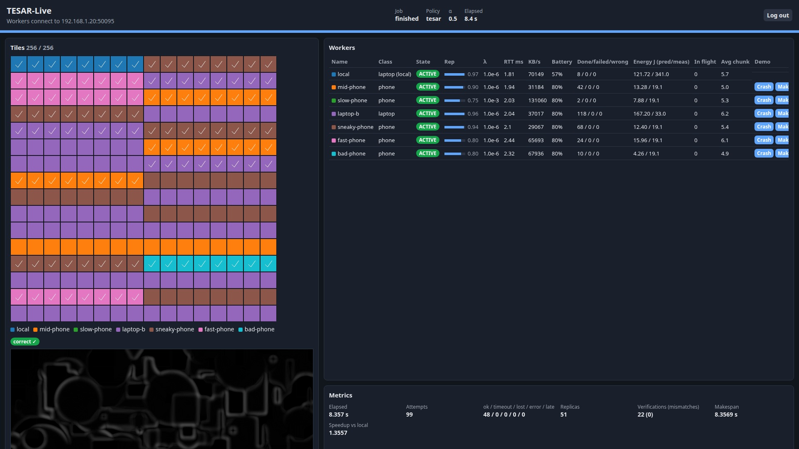
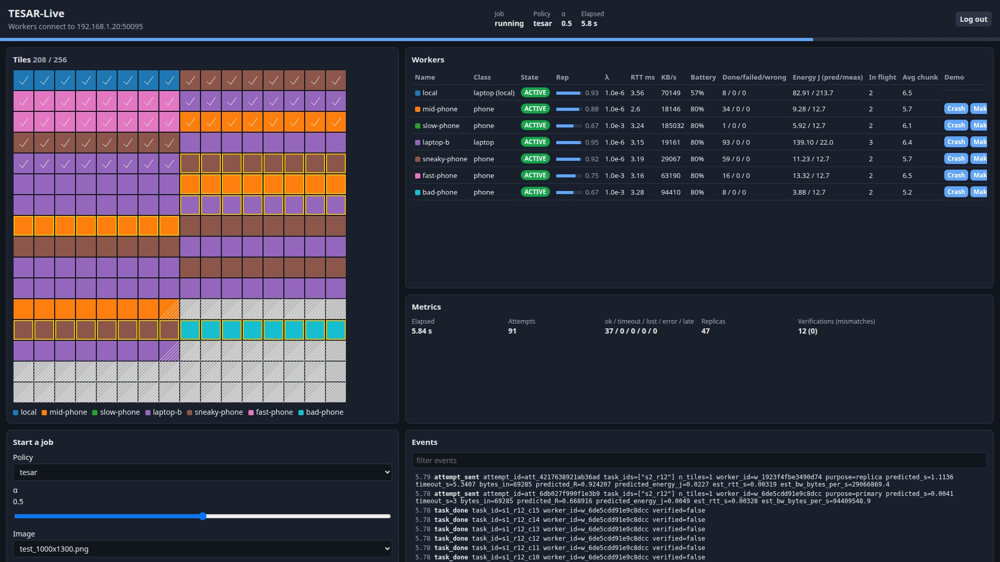
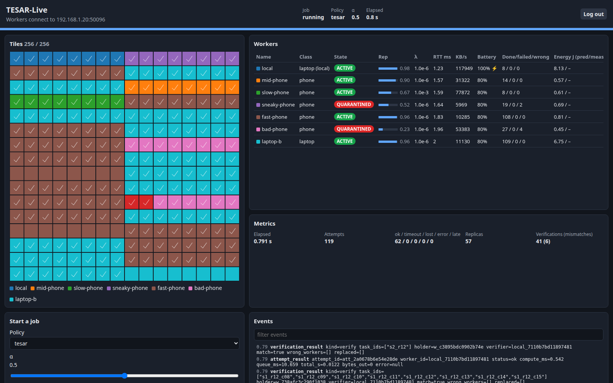
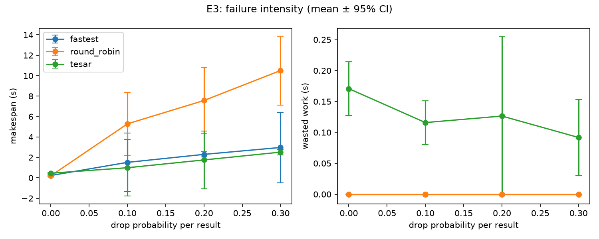

<div align="center">

# TESAR-Live

**Reliability-aware compute offloading for a mobile device cloud: real sockets, real phones, real failures.**




</div>

A laptop splits a heavy image-processing job into tiles and offloads them to nearby phones
and laptops over the local network. Phones are fast but unreliable: they are slow, run low on
battery, walk out of WiFi range, and sometimes **return wrong answers**. For every task,
TESAR-Live decides where to run it by trading **execution speed** against **reliability**,
under **energy** limits. It survives crashes and disconnections, catches workers that lie, and
always delivers a **byte-exact correct result**.

The scheduling model is inspired by Saha et al., *"Tradeoff between execution speedup and
reliability for compute-intensive code offloading in mobile device cloud"* (Multimedia Systems,
2019). Most work on that paper's topic lives in simulators. This project builds the idea as a
real distributed system.

---

## Contents

- [Why](#why)
- [How it works](#how-it-works)
- [Features](#features)
- [Screenshots](#screenshots)
- [Getting started](#getting-started)
- [Running on real phones](#running-on-real-phones)
- [Testing and quality gate](#testing-and-quality-gate)
- [Experiments](#experiments)
- [Project layout](#project-layout)
- [Documentation](#documentation)
- [Roadmap](#roadmap)
- [License](#license)

## Why

Most people have one busy computer and several idle phones within reach. Using those phones
as extra compute sounds easy until you meet the four kinds of mess:

| Problem | What TESAR-Live does |
|---|---|
| **Uneven speed:** an old phone is 3× slower than a new one | Measures each device's RTT, bandwidth and compute speed, and sizes the work it gets (adaptive chunking) |
| **Battery:** a phone at 12 % should not drain itself for you | Per-job energy budgets and a hard battery floor that every policy obeys |
| **They leave:** WiFi drops, apps get killed | Heartbeats, timeouts, retries, replicas and a trusted local fallback. A job never hangs. |
| **Some lie:** a buggy or malicious device returns plausible wrong results with valid checksums | Spot-check re-execution, strikes, quarantine and **retroactive repair** of everything the liar touched |

## How it works

```
                 ┌───────────────────────── Coordinator (laptop) ─────────────────────────┐
 Browser ◄─ws──► │ Dashboard (aiohttp :8080)                                              │
                 │      ▲ events                                                          │
                 │ Job (DAG) ◄──► Scheduler ──► Policy (local/rr/fastest/reliable/tesar)  │
                 │      ▲             │  uses: NetEstimator, Reputation, Energy,          │
                 │      │             ▼        Chunking, Registry                         │
                 │ Assembler ◄── Dispatcher ──► Verifier (spot checks, quarantine, taint) │
                 │                   ▲   FailureDetector (ping/pong, timeouts)            │
                 │ TCP server :50010 ┘   UDP beacon → :50000 (broadcast + multicast)      │
                 └──────────────▲─────────────────────────────────────────────────────────┘
                                │ TLS/TCP (worker-initiated, pinned cert, mutual auth)
          ┌─────────────────────┼─────────────────────┬────────────────────────┐
     Local worker (trusted)   Phone A (Termux)      Phone B (Termux)       Laptop C
     subprocess, 127.0.0.1    numpy + threads       battery via termux-api  sysfs battery
```

1. **Split.** The image becomes a task graph: tiles → per-row statistics → final assembly.
2. **Estimate.** For each device the coordinator keeps a Beta reputation, a failure rate λ,
   network estimates and an energy model. Together they predict, for each device and task, the
   finish time `T` and the success probability `R = rep · e^(−λT)`.
3. **Decide.** The `tesar` policy picks the device with the lowest cost
   `α · speed_cost + (1 − α) · κ · (−ln R)`. α is the knob: 1 means fastest, 0 means safest.
   If even the best device is too risky, it sends backup copies until the combined reliability
   reaches a target.
4. **Verify.** Results from new or low-reputation devices are re-computed on the trusted
   worker. A mismatch is a strike. Two strikes put the device in quarantine, and every
   unverified result it produced is recomputed, along with everything derived from it.
5. **Assemble.** The final image is checked byte-for-byte against a local reference.

The full design is in [docs/ARCHITECTURE.md](docs/ARCHITECTURE.md). The comparison with the
paper's model is in [docs/TESAR_ALIGNMENT.md](docs/TESAR_ALIGNMENT.md).

## Features

**Networking and security**
- asyncio TCP with a framed binary protocol (MDC1), TLS 1.2+ with the coordinator certificate
  **pinned** in every join code, and **mutual HMAC authentication**
- Per-device enrollment with join codes (QR or file), instant revocation and secret rotation
- Automatic discovery over UDP broadcast and multicast, or a direct `--coordinator HOST:PORT`
- Strict input validation, size limits, decompression-bomb guards, per-IP connection limits

**Scheduling**
- Five policies: `local`, `round_robin`, `fastest`, `most_reliable` and **`tesar`**
- Replication up to a reliability target, adaptive chunking per device
- An offline **MILP optimum** (PuLP + HiGHS) to measure how far the online greedy rule is from
  optimal

**Fault tolerance and trust**
- Heartbeats (ACTIVE → SUSPECT → DEAD), per-attempt timeouts, late-result handling, retries
- Result verification with probation, sampling, tie-breaks, strikes and sticky quarantine
- **Taint propagation:** a quarantined device's unverified work, and everything built on it,
  is recomputed automatically
- Collusion detection between devices that agree on wrong answers

**Energy**
- Energy model `E = p_compute · t_compute + p_tx · t_transfer` with per-job budgets
- Battery floor, measured drain from the phone's current and voltage, and least-squares
  calibration from real runs

**Live dashboard**
- Tiles coloured by device as they finish. A worker table shows state, reputation, λ, RTT,
  bandwidth, battery and energy, next to live metrics and a filterable event log.
- Start jobs and set policy, α, image, verification and chunking from the browser
- Token login, sessions, CSRF protection, Host/Origin checks, strict CSP. Works offline.

**Engineering**
- Over 1,460 tests: unit, property and fuzz, security, integration, end-to-end with real
  processes, performance, and a 40-job **chaos soak test**
- Lint, mypy, bandit, a forbidden-pattern scan, pip-audit and per-module coverage
  thresholds, all run by one gate script
- Reproducible worker package (deterministic zip + SHA-256, scanned for secrets)

## Screenshots

**A job in progress:** every tile is coloured by the device that computed it. Grey tiles are
waiting, hatched tiles are running, tiles with a yellow outline are being re-checked, and tiles
with a check mark have been verified.



**Catching liars:** `bad-phone` and `sneaky-phone` return wrong results that carry valid
checksums. Re-execution on the trusted worker exposes them, both are quarantined, and the
tiles flashing red are recomputed. The final output is still correct.



## Getting started

### Requirements

- Python **3.10+** on Linux or macOS (the coordinator). Workers need only Python and numpy, so
  they also run on Android through Termux.
- No root, no cloud account, no external services.

### Install

```bash
git clone https://github.com/mashfikuzzaman-2023415968-cell/TESAR-live.git tesar-live
cd tesar-live
python3 -m venv .venv && . .venv/bin/activate
pip install --require-hashes -r requirements.lock   # pinned, hash-checked runtime dependencies
pip install -r requirements-dev.txt                 # tests, lint, security tools (optional)
```

### Run a demo on one laptop (three commands)

```bash
python scripts/make_test_images.py
python -m mdc.coordinator --run-job --wait-workers 5 --set network.max_connections_per_ip=8
python scripts/local_cluster.py configs/cluster_profiles/hetero5.yaml     # in a second terminal
```

The second command starts the coordinator. It prints the dashboard URL
(`http://127.0.0.1:8080/login`) and the path of the admin token file (`~/.mdc/admin_token`,
readable only by you). The third command starts five emulated devices: fast and slow phones, a
low-bandwidth phone and a laptop. They join next to the trusted local worker, and the `tesar`
policy runs a 2048 × 2048 image job.

Results land in `runs/latest/`:

| File | Contents |
|---|---|
| `output.png` / `reference.png` | the distributed result and the local reference (byte-identical) |
| `report.json` | makespan, speedup, attempts, failures, energy, verification statistics |
| `events.jsonl` | every scheduling, network and verification event |
| `snapshot.json` | the estimates used, for offline MILP comparison |

Press **Ctrl+C** in both terminals to stop. Add `--headless` to run without the dashboard.

### More scenarios

```bash
python scripts/local_cluster.py configs/cluster_profiles/hetero_faulty6.yaml     # crashes, drops, flaky WiFi
python scripts/local_cluster.py configs/cluster_profiles/hetero_malicious6.yaml  # workers that lie
python scripts/chaos.py --stop slow-phone@3 --cont slow-phone@10 --events runs/latest/events.jsonl
python -m mdc.coordinator.policies.milp_offline --snapshot runs/latest/snapshot.json   # vs the optimum
```

Use `--wait-workers 6` for the six-device profiles. Set `network.max_connections_per_ip` to at
least the number of workers + 2, because emulated workers all connect from one address.

### Using the dashboard

Open the printed URL and paste the token from `~/.mdc/admin_token`. From there you can start
jobs (policy, α, image, iterations, verification, adaptive chunking) and watch them live.

Demo buttons (crash a worker, make it malicious, slow it down ×3) are off by default. They
appear only when the coordinator runs with
`--set security.lab_mode=true --set dashboard.demo_controls=true` and the workers run with
`--lab-mode --allow-demo-control`.

## Running on real phones

```bash
python -m mdc.coordinator --diag                    # LAN address, ports, test beacon, fingerprint
sh scripts/package_worker.sh                        # dist/mdc-worker.zip + .sha256 (no secrets)
python -m mdc.cli enroll --name phone-a --qr        # scan the join code with the phone
```

On the phone, using [Termux](https://f-droid.org/packages/com.termux/) from F-Droid:

```bash
sh scripts/termux_setup.sh
python -m mdc.worker --join-file phone-a.join --device-class phone --battery termux
```

Device management:

```bash
python -m mdc.cli list-devices                     # never shows secrets
python -m mdc.cli show-fingerprint                 # the certificate fingerprint workers pin
python -m mdc.cli revoke --name phone-a            # lost or stolen phone: takes effect immediately
python -m mdc.cli rotate-secret --name phone-b --out phone-b.join
python -m mdc.cli calibrate-energy --runs runs/    # fit energy constants to measured runs
```

> Join files contain a secret. Transfer them privately (QR code or USB), never over plain HTTP.

Worker options: `--coordinator HOST:PORT`, `--slots N`, `--battery auto|termux|sysfs|mock`,
`--min-battery 15`, `--device-class phone|laptop`, `--diag`. Fault-injection flags
(`--drop-prob`, `--malicious-prob`, `--slowdown`, `--flaky-mean-s`, `--collude-key`, …) are
refused unless `--lab-mode` is also given.

The step-by-step guide, with network troubleshooting and an acceptance checklist, is in
[docs/DEPLOYMENT_TERMUX.md](docs/DEPLOYMENT_TERMUX.md).

## Testing and quality gate

```bash
python -m pytest -m "not e2e and not soak and not perf"  # fast suite (~1.5 min)
python -m pytest -m e2e                                  # real processes over real sockets (~1 min)
python -m pytest -m soak                                 # 40 jobs under random chaos (~1 min)
python scripts/phase_gate.py --phase 14 --repeat-e2e 3   # the full gate
```

The gate runs, in order:

- formatting, lint, mypy and bandit
- a forbidden-pattern scan, a worker-isolation check and pip-audit
- every test suite, with coverage
- per-module coverage of security-critical code
- a guard that fails on skipped tests
- a clean-checkout run of the quick start above

See [docs/TESTING.md](docs/TESTING.md).

## Experiments

```bash
python experiments/run_matrix.py configs/experiments/e3_failure_sweep.yaml
python experiments/plots.py runs/e3_failure_sweep        # figures with 95 % confidence intervals
```



As devices drop more results, `round_robin` collapses (0.2 s → 10.5 s), while `tesar` degrades
the least and ends up fastest at a 30 % drop rate.

There are six experiments: E1 baselines, E2 the α tradeoff, E3 failure intensity, E4 chunking,
E5 malicious workers and E7 greedy vs MILP. All results, with an honest reading of what they
do and do not show, are in [docs/results/](docs/results/README.md). The experiment design is in
[docs/EXPERIMENTS.md](docs/EXPERIMENTS.md).

## Project layout

| Path | Contents |
|---|---|
| `mdc/common/` | protocol, TLS, authentication, credentials, validation, config (worker side: stdlib + numpy only) |
| `mdc/tasks/` | deterministic compute kernels (blur + edges, row statistics, synthetic) |
| `mdc/worker/` | worker process for phones and laptops: discovery, battery, fault injection, traffic shaping |
| `mdc/coordinator/` | server, registry, job DAG, dispatcher, scheduler, policies, estimators, verifier, metrics |
| `mdc/dashboard/` | live web dashboard and its security layer |
| `configs/` | default config, cluster profiles, experiment matrices |
| `scripts/` | quality gate, scanners, cluster launcher, chaos tool, packaging, Termux setup |
| `experiments/` | experiment runner and plotting |
| `tests/` | unit, property/fuzz, security, integration, e2e, perf and soak tests |
| `docs/` | design documents, results and screenshots |

## Documentation

| Document | What it covers |
|---|---|
| [ARCHITECTURE](docs/ARCHITECTURE.md) | components, data flow, scheduling loop |
| [PROTOCOL](docs/PROTOCOL.md) | MDC1 wire format and message types |
| [SECURITY_DESIGN](docs/SECURITY_DESIGN.md) | threat model and defences |
| [TESTING](docs/TESTING.md) | test suites and the quality gate |
| [DEPLOYMENT_TERMUX](docs/DEPLOYMENT_TERMUX.md) | running workers on Android phones |
| [EXPERIMENTS](docs/EXPERIMENTS.md) | experiment design and how to reproduce |
| [DEMO_SCRIPT](docs/DEMO_SCRIPT.md) | a guided live demo |
| [TESAR_ALIGNMENT](docs/TESAR_ALIGNMENT.md) | the scheduling model vs the original paper |
| [DECISIONS](DECISIONS.md) · [PROGRESS](PROGRESS.md) · [OBSERVATIONS](OBSERVATIONS.md) | design decisions and build log |
| [SECURITY](SECURITY.md) | security policy and how to report issues |

## Roadmap

- Field tests on a fleet of real Android phones, and energy constants calibrated from real
  battery measurements
- Persistent job state so jobs survive a coordinator restart, plus a job submission API
- More task types through a versioned plugin interface (or sandboxed WebAssembly)
- A native Android worker app in place of Termux
- Prometheus metrics, a Docker image, and CI on real hardware
- An independent security review

## Citation

The scheduling model builds on:

> S. Saha, M. A. Habib, T. Adhikary, M. A. Razzaque, M. M. Rahman, "Tradeoff between execution
> speedup and reliability for compute-intensive code offloading in mobile device cloud,"
> *Multimedia Systems* 25, 577–589 (2019).

## Acknowledgements

Developed with AI pair-programming assistance (Claude Code). Every change passes the same
automated quality and security gate described above.

## License

[MIT](LICENSE) © 2026 Mashfikuzzaman Taeen
